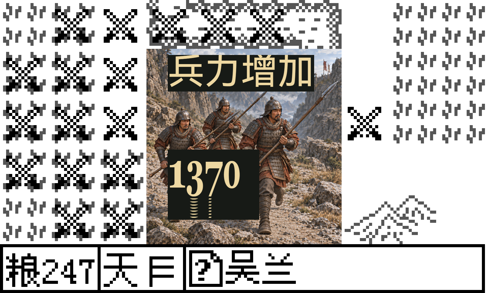

# AID41：当前安装版 PC720 援兵／援军高清实战

本批接受当前安装版 **1280×720** 中技能17、29的两次独立高清实战，`actualCastAccepted=true`、`installed720HdAccepted=true`、`hdAccepted=true`；`wholeHdAccepted=false`、`globalHdComplete=false`。旧安装1080高清、旧暂存720高清、精确缺图及[本日经典LCD](m5-aid-classic-20261023.md)仍分别保留原执行来源，本批没有重新验收完整当前矩阵。

两场各自公开导入并真正原生 LOAD 同一份已认可的独立 AID 冻结输入：原版时期3／玩家9刘璋、212年8月、`caster188-owned`，identity=`v1:414390:1d36da77:1e9c0477`。sango0为8221字节、SHA256 `5e8eb45f4e7712d3e63982db03c5616ec7866a75b109ab186725b4eef938b20d`；sango1为4840字节、SHA256 `8f73a71dfba722cd2e3c33824853bc8a82886180030ed5d63a45a52c18939f97`。approved-v5完整准备结果同时锁定48322439字节及SHA `e467cecf81eca3c997b6afd4168aec2037e92ebaf1c24fe6e384ed64b55cf782`。只把该旧结果当作精确依赖，没有重做取得过程，没有载入或回退主撞击活动的时期4／玩家0／最新四月存档。

原生 LOAD 后重新核对200名武将、38城、居民队列、活动订单、600字节出征数据和日期；独立双读当前实际原版 LIB 并核SHA。南方小鬼188／Lv20玄兵与吴兰144从己方巴郡31真实出征武陵32，原生27订单、两名将领、携粮、实际钱粮变化及当前友军 AIM 均有原始回执。两场分别先完成无浏览器／无HTTP纯preflight，之后各启动一次私有真实浏览器，不从观察超时重开同局。

| 技能 | 实际 MP | 吴兰实际兵力 | 实际增量 | 电影LCD回调 | NUM／HOLD读回 | 全部高清读回 |
| --- | --- | --- | --- | --- | --- | --- |
| 17 援兵 | 146→131 | 100→900 | +800 | 8 | 15 | 23 |
| 29 援军 | 146→116 | 100→1470 | +1370，受实际容量1470限制 | 8 | 18 | 26 |

两场都沿当前公开HD目标点击确认，真实MP分别扣15／30。当前实际友军AIM、actor／target、generation、完整电影0..7、GBK「兵力增加」、NUM15八次原生上升绘制轨迹、完整50 tick等待及结果退休分别核对。电影／数字／等待期间没有额外键或跳过；名义Power1800没有冒充实际+1800。每场只验自己的显式技能，原继承检查点名`05-two-AID-owners-retired`不代表单场已验两技能。

严格验证器以完整160×96原版LCD作底，只认证实际 `(48,16)64×64` 高清窗口，要求49份选中电影／NUM／HOLD读回全部来自`hd-assets`。本批共752640个原生逻辑像素，累计清除、标签、数字及窗口外完整LCD逐项独立重算；高清原PNG、真实绘制日志、裁剪、坐标、字体加载、素材内部取样和完整等待均通过。49份HD Canvas原PNG的窗口外共有 **66784256个backing像素**，均和本次原生LCD的实际最近邻映射一致。实际render scale为11，PNG为1760×1056，另以当前DOM验证其显示几何；这些是Canvas读回像素，不能称为硬件屏幕像素或物理刷新帧。窗口内插画缩放与抗锯齿字形采用真实绘制轨迹及原图邻域取样验证，没有声称每个内部高清像素都与原图逐字节相同。

49份读回由47次实际LCD回调及两次完整HOLD读回组成，分别计数。正常运行内的严格oracle、终态后的独立完整重验，以及[root再次独立重验](m5-aid-installed720-20261023/root-revalidation-index-v2.json)都接受同一批未修改原记录。后两次均为离线复核，零新增浏览器／游戏输入，不新增真实cast或矩阵信用。

两场各冻结1230项来源，前后漂移／新增均0；native128仍为 `713f2425551f3fbf3b9f0f892eeada969161c070c465e159f4126f1dd1944d9d`。本批未改产品JS／CSS／PNG／原生源码，未重编引擎，正式经典运行器保持原字节。执行的是独立build候选，SHA `d8be23283f4e4d07425424a4b01be7987533e332a655337f7859b4b3270caacf`；当前严格oracle SHA `3aabc6ee0486955226dfd631c750466492203a927a45c258ffa2ad1372843c48`，两份精确执行代码均已归档。

技能17的真实terminal session为61725，初始chunk `7e71d1`、终态chunk `94bfa0`／exit0；技能29为2649、`b10cd3`→`1cbda1`／exit0。完整工具观察序列、命令及输出都保留。两场各8个已记录出生时间／执行文件／私有profile的Chrome进程全部退出，私服及调试端口关闭，另由当前OS精确身份／profile／端口读取复核；私有profile按现代流程保留。用户8080在本轮前后两次采样时均没有监听、HEAD连接被拒绝，前后状态一致，不能沿用旧历史HTTP200正常的描述。

首版离线终审曾错误要求8080为200，修正为验证实际前后baseline一致后通过；该失败源及原因保留，没有新局或数据变化。root的首次离线工具缺少验证器要求的`pstring.h`资产Map而拒收，补齐实际已固定资产后重验通过；失败源和有效工具v2均保留，也不算新的实战。

[汇总JSON](m5-aid-installed720-20261023.json)、[原始索引](m5-aid-installed720-20261023/runtime-index.json)保留209个逻辑文件，以及[root补充索引](m5-aid-installed720-20261023/root-revalidation-index-v2.json)的3个新对象。当前全部机器记录、执行代码、原双SAVE和每份captured native／LCD／HD PNG都保留原字节。49份HD PNG去重为35张原图、40565260字节，装入独立二进制solid Brotli包后为23350356字节；索引逐张保存offset／长度／SHA，逐字节解压验证，没有重编码、缩图或删除实际HD PNG。另附两张原字节预览。

运行 `node docs/validation/m5-aid-installed720-20261023/verify-archive.mjs` 可只读验证原索引、root补充、所有原文件及PNG的完整SHA。该reader还导出`readArchivedOriginal(originalPath)`，可以按索引原路径取回精确字节；无需旧48MB准备结果或私有profile即可检查当前已归档证据。8张补充准备／动作后整页图只保留字节与SHA清单，本地原件仍在；旧准备历史、产品依赖全副本和浏览器profile没有递归归档，所以`portableClosedArchive=false`，不把机器证据／captured PNG闭合扩大为所有外部依赖闭合。

本批只补当前安装版PC720的17／29子范围；此前各高清、精确缺图及经典记录维持各自已接受范围，没有获得本批额外重跑信用。隐藏／可见性／resize、手机／真机、性能、完整战役、RNG连续性及整体HD继续待验。

技能29完整HOLD的原始HD Canvas预览：

