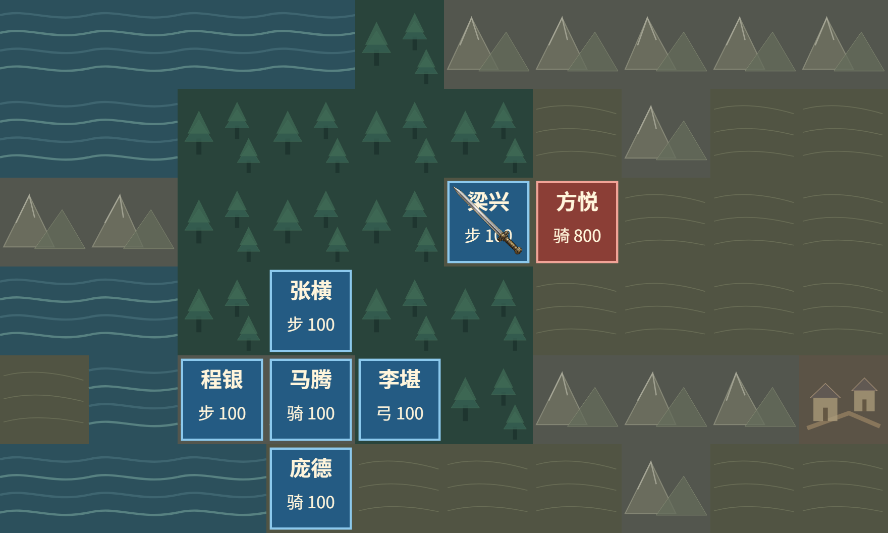
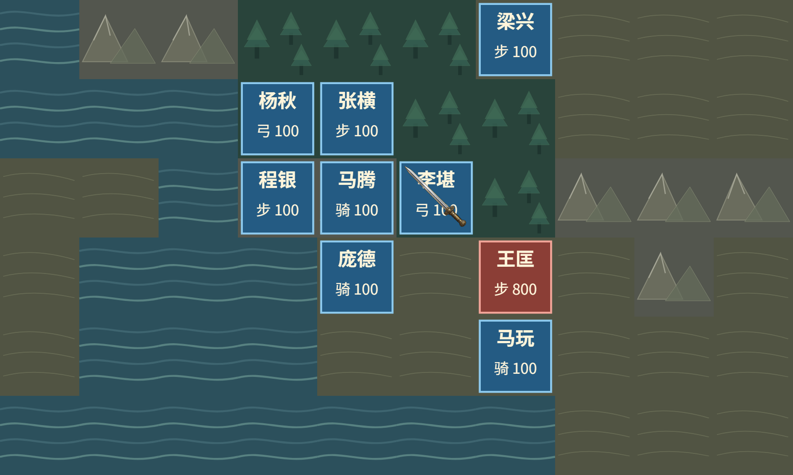

# 原版战场状态效果的独立高清场景

2026-10-11：原版 `STACHG27` AI 目标、升级和退场提示新增独立高清战场背景，使用事件实际的原生 10×6 视窗、地形和参战将领。动画仍沿原生复制帧、透明素材和清除记录播放，不移动行动镜头，不增加输入或改变等待规则。原版唯一入口及暂停版本切换保持。

原有原生身份、资源、RGBA 底图、当前显示提交和回调认证全部保留。新场景另外复核原版 LIB、完整地图、20 个参战槽位、人物和装备兵种、实际目标坐标及绘制前后的代次。退场状态 8 仍可认证效果位置，但不再绘制参战牌；初始化 phase2 按原生顺序允许战斗 active0。认证不成立或绘画失败时恢复原 LCD 路径。本批没有新增 native 构建或素材。

| 实际运行 | 结果与范围 |
|---|---|
| PC 1920×1080，正常高清 | P1 马腾经公开出征进入河内，第 5 次自然敌回合触发 AI 目标；5 个真实提交的原生完整 LCD AND/OR、调色板和时序验算通过。高清目标位置、帧与清除、实际背景外部像素及透明图层合成通过。 |
| PC 1280×720，目标图 7 私有响应 404 | 第 3 次自然敌回合触发 AI；5 个提交保持完整 LCD，高清绘制数 0，缺图回退通过；原生产图片未改。 |
| 手机模拟 844×390、667×375，各独立新局 | 各第 3 次自然敌回合触发 1 个 AI 事件、5 个高清提交。原生视窗和目标将领投影、彩色画面及舞台边界、行动镜头不变和只读显示归属通过。各共 38 个原生键、0 LCD 触摸；三个回合各仅显式系统/结束两键，无自动确认。 |

最终 **89 模块串行 4207／4207 通过**，失败、取消、跳过和 todo 均 0；230 份执行来源无漂移。正常 PC 和缺图 PC 各 1219 份运行来源无漂移，两个成功手机局各 143 份无漂移。六次尝试全部列入[结构化记录](m5-battle-scene-20261011.json)：四次成功、两次验证工具失败，失败原件保留。

首次手机采样误把原生数组代理当作普通数组切片，随后观察不足并自然战败，整局不接受；修复采样后两尺寸分别重跑。首次 PC 工具使用浮点透明色算法，在重叠帧 16/17 与 Chromium 的 U8 预乘整数计算不同。修正工具后新增四个正反例，像素门收紧为精确预乘字节匹配，未扩大容差；旧局仍不接受，正常 PC 新局重新验证通过。

六局均完成私有浏览器树和 HTTP 服务清理。独立终态复核 74 个历史进程身份均不再存活、12 个私有端口无监听；原 8080 服务 PID、出生时间和执行文件保持一致，HTTP 200。私有 profile 保留，不进入归档。

验收只覆盖本批实际 AI 场景。升级、退场和初始化路径已有产品与纯测试，尚未新增自然触发实测；HD 像素验证使用实采地形/字体背景和解码素材，不独立重绘地形、字体；手机不授逐像素合成一致。其它效果、完整战斗流程、真机和性能仍待，`globalHdComplete=false`。

[压缩证据索引](m5-battle-scene-20261011-archive.json)记录原件及压缩件 SHA256；[归档与安装复核](m5-battle-scene-20261011-verification.json)给出最终核验。忽略目录另保留开局截图和完整私有运行资料；归档仅包含索引明确列出的证明文件。
