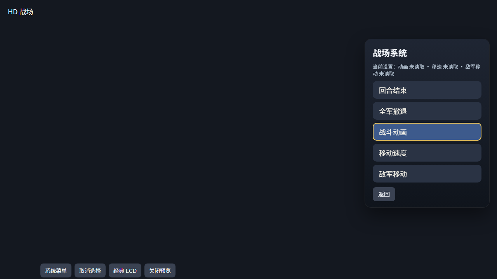
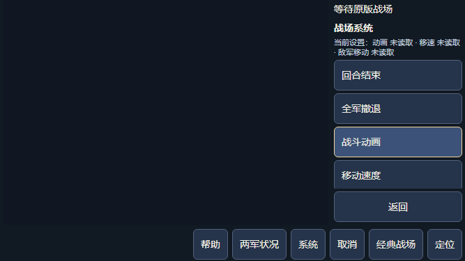

# 战场菜单当前设置（V80，轻量开发验证）

2026-10-26，原版 PC／手机战场“系统”及“设置”菜单新增当前现值摘要：动画、移速、敌军移动。读取 g_LookMovie／g_MoveSpeed／g_LookEnemy，0／1 分别是“不看／观看”“快速／慢速”“不看／观看”。原生初始化均为 1，并随存档保存、恢复；不是每场战斗重置。非严格 0／1 的单项显示“未读取”，不强转布尔值。

子菜单只有浏览高亮，原 C 在确认后才写设置，取消保持原值。动画与敌军移动子菜单名称相同，桥接也没有当前 var 标记，因此始终展示三项现值，不按高亮或历史菜单猜当前修改项。“敌军移动不看”只控制展示，不表示停用 AI。

摘要复用只读战场状态读取器的原版 LIB／玩家战场／数据与 API 守门，绑定当前 SYSTEM6 或 SETTINGS8 原生菜单、名称、序号、索引、代次及 wait／phase 原始镜像，三次采样一致才显示。来源漂移、重入、报告接管或退离菜单时清空摘要；weather／粮草读取分支与设置分支各自独立。原按钮顺序、禁用、取消和一次确认协议保持，无直接设置写入，无 C／WASM 改动。

四个相关模块新跑 **265/265**，净新增 3 组，失败／取消／跳过／todo 均 0，20 件所选来源保持；含 Clang18 执行的已有 C 主菜单合同。覆盖现值组合、未知单字段、同名子菜单、未提交高亮、来源／原始镜像漂移与重入、原菜单及零原生输入／零世界写入观察。设置映射的原 C 已只读核对，不将旧 C 菜单合同当作设置功能的实际运行验收。

PC／手机各一次受控静态布局检查采用最长“未读取”示例：摘要完整、无横向溢出，菜单与返回按钮在窗口内，手机列表可滚动且按钮至少 44px。初始 DOM 为 1264×625／651×280，PNG 为 1280×720／667×375，分别记录；两次自有 Chrome 正常退出。

复核命令（Windows 需设置可用 CC）：

    node --test --test-reporter=tap --test-concurrency=1 scripts/test-hd-battle-commands.mjs scripts/test-hd-battle-mode.mjs scripts/test-hd-battle-mobile-host.mjs scripts/test-hd-mobile-battle.mjs

[结构化记录](./m5-battle-settings-20261026-v80.json)保存来源与原始日志 SHA；本地原件位于 build/battle-settings-20261026-v80/。本批没有实际战斗中的设置提交、存读档或全量验证。旧战局未接入、关闭或重开；实际流程、全量与调优后排，整体 HD 仍 partial。
