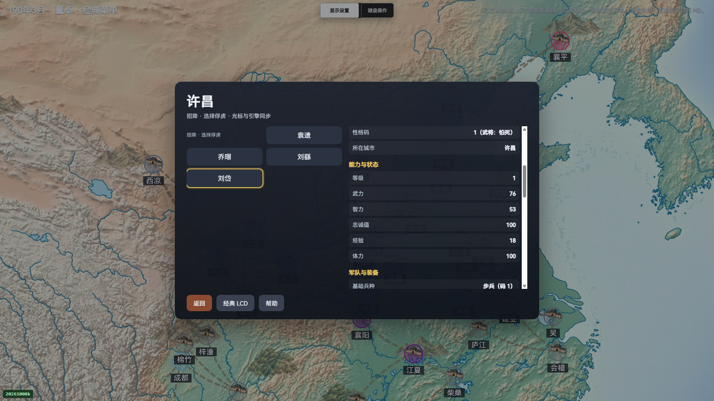
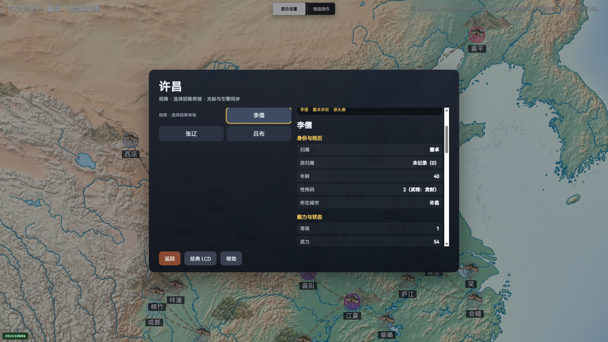

# 原版招降双人物阶段与真实俘虏验证（V73）

2026-10-26，本批修复招降的俘虏目标／己方招降将领两个 PERSON 阶段，以及取消和异步名单回执。当前只接受原版 P1 董卓、PC1920×1080 的下述实际范围，整体 HD 继续 partial。

公开只读复核：

    node docs/validation/m5-captive-person-20261026-v73-verify.mjs

用户“保留旧战局，暂不重开；继续其他 HD 开发”的决定保持。旧 held 战局没有输入、重载、关闭或控制接口接入；下述均为独立新局，不串接为同一历史世界或 RNG 连续性。

## 产品变化

原版招降先调用俘虏 PERSON，再调用己方将领 PERSON；取消将领选择会重新打开俘虏名单。HD 现分别显示“招降 · 选择俘虏”和“招降 · 选择招降将领”，等待真实新菜单后再采用下一阶段；取消目标后须见到新的原生 MAP 回执才退壳。PC 定时观察会同步晚到的 PERSON，保留手机原有定时刷新。

私有流程只能从完整当前内政子菜单的招降项进入。原 LIB、当前 data／config／城市／完整名册、人物 ID／姓名、来源函数和原生菜单代次共同绑定；名单按 C 的队列顺序区分俘虏和己方，保留合法重复记录。稳定阶段拒绝整段名册变化，重入使当前读取失效。ENTER／EXIT 在导出前预约，未知结果不能通过关闭或经典／HD 往返重发；真实新菜单或限定的新 MAP 回执才释放。没有增加公开移动输入能力，也没有据此授予实际招降订单或费用成功信用。

## 实际新局

P1 董卓在洛阳15正常征兵七次，每次720兵／72钱，合计5040预备兵／504钱；一次正常 END 归队后，吕布20、张辽22、李儒19分别按原生上限分配1730、1850、1560兵。一次真实15→16出征，再执行一次 END，自然完成9回合战斗并占领许昌16，日期190-1→190-2→190-3。全部原生准备、派军、结算及实际伤亡保留。

实际获得袁遗77、乔瑁76、刘繇75、刘岱8四名俘虏，均在已采许昌队列，Belong=65535／OldBelong=9／Arms=0。原始开局完整已采200人物没有俘虏。四人各检查完整姓名、HD归属、原归属和原生属性0，以及 HD所在城市／实际翻页的原生属性1；己方招降者李儒19另做完整身份检查。合计5人次／25个身份观察、4人次／8个位置观察。这些是浏览器目标，不是33项新增单元测试。

每名俘虏实际37→36翻页并返回第一页，共8个原生分页键。独立原ROM提供姓名、城市名和原生标题；位置由捕获后的当前完整队列首次匹配，不能用ROM初始驻城代替。位置均为许昌16。每次观察及真实wheel保留全部已采native／world、零新增原生键／LCD触摸；分页只允许person页变化，其余已采native保持。真实战后遗留的出征完成阶段7原样验证，没有归零或改写采样。

随后唯一目标39进入己方名单，唯一将领40返回新的俘虏名单，再唯一目标40返回MAP。没有确认招降将领，招降订单0，整个检查期间已采世界保持。完整报告120阶段、冻结1225来源，任务自有Chrome全部退出，profile保留，私有HTTP关闭。

## 回归与保留失败

当前 HUD216／216、手机菜单模块504／504均通过，二者都是完整默认150文件7957／7957的专项子集，不重复加总。默认净新增14项；实际Clang18，1651份所选来源整场稳定，失败／取消／跳过／todo全0。原产品负控203通过／13失败，缺PC定时同步的V6负控215通过／1失败，均保留真实child exit1。

| 独立记录 | 原始结果与边界 |
| --- | --- |
| preflight-before-v1 | 仅来源预检，0浏览器／0游戏；accepted=false |
| pc1080-before-v1 | 七次征兵已付款，尚未END；退休HD壳消费了唯一Escape，验证器等待系统菜单失败；22阶段／false |
| pc1080-before-v2 | 真实两次END、胜利和四名捕获；helper误把公开进城接口的坐标对象当作true，人物检查前失败；77阶段／false |
| pc1080-after-v1 | V6真实进入原生俘虏名单，但PC异步发布后未刷新HD，界面等待超时；83阶段／false |
| pc1080-after-v2 | 本批120阶段实际通过；四俘虏、身份／位置和双人物取消链只在此授予接受 |
| full-default-v1 | 7955／7956，唯一旧mobile隔离fixture缺少新render依赖而失败；1651来源仍零漂移，不改成成功 |

旧fixture现组合真实render facade、私有guard／render body及sync函数的无流早返路径，原行为断言保持，函数定位guard随组合范围增强；源文件原CRLF合同保留。V1至V6候选、readonly重入／最后actor／经典取消／真实poll-only负控、各原失败、机械字节变换与源准备错误均保留。完整原始JSON和PNG按原字节归档，不裁剪或重序列化后冒充原件；只读验证器不执行归档runtime或oracle。

## 来源与范围

当前161关键源、9件父源变化及1件新增helper明确区分；本场runtime与关键源交145／差16，差集只核当前字节，不宣称在本轮执行。原生128份仍聚合617c3aea…，没有改C或重建WASM；既有引擎manifest的旧版本与modified=true保持。逻辑人物200与底层人物2000／名册2000／38城分开。最终实际LIB完整HEX双读保留，可独立重算207195字节／3bd20146…；早期失败报告只保留原身份元数据，其缺失HEX不补造。

本批没有实际招降提交／成功、在野人物报告、其它时期、PC720或手机俘虏新局、全部13属性、任意Mod、真机或稳定性能接受。WOOD／AID同会话闭环、完整ABI／packed SAVE／历史RNG、云服务和整体HD继续partial。
