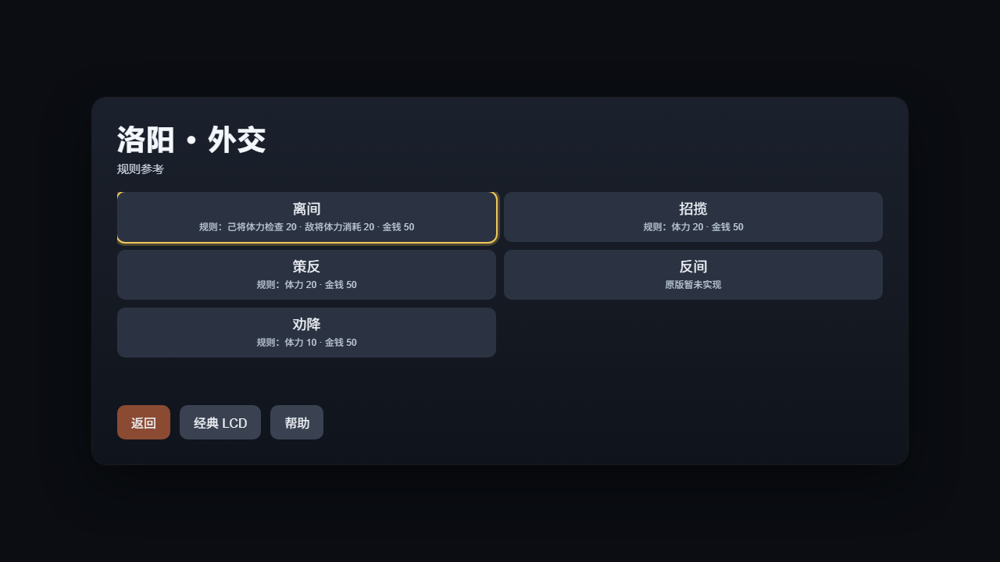
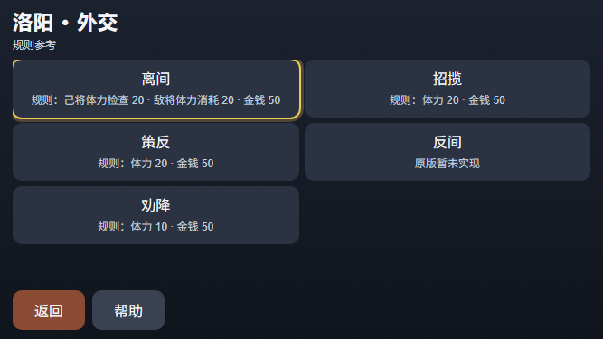

# 外交与军备消耗规则提示（V85，轻量开发验证）

2026-10-26，PC／手机补齐外交与军备的 10 项规则参考，与 V84 内政合计覆盖三组 24 项菜单。保留原名、原顺序与点击委托；只说明规则，不判断当前人物可执行性或资源是否足够，不禁用按钮。

| 菜单 | 原生费用语义 |
|---|---|
| 离间15 | 检查己将体力 T15；fixAlienateComsumeThew 非零扣己将，否则扣敌目标体力；金钱 M15 |
| 招揽16／策反17／劝降19 | 对应指令的体力与金钱表项 |
| 反间18 | CityCommon 直接跳过，RealienateMake 也为空；明确显示“原版暂未实现” |
| 侦察23 | T23／M23 |
| 征兵24 | T24，金钱先检查 M24，实际扣 floor(所选兵数 / armsPerMoney)，显示每若干兵1钱、余数不计 |
| 分配25 | 无体力或金钱消耗，仍由原生调整现有兵力 |
| 掠夺26 | 检查／扣除 CONSCRIPTION 的 T24，无金钱扣费，不误读 T26／M26 |
| 出征27 | M27 及自选携粮，不扣 T27 |

实现沿用原版 LIB 身份、当前己方城、原始 SUB 镜像与三次一致捕获；两组虽同为 5 项，也必须完整名称匹配，不能借旧界面标签互认。新增配置按所属组读取，非法／缺失、来源漂移或自定义可执行 hook 时撤回说明，读取不执行 hook。原版内政接口默认值保持；普通轮询同时刷新三组，稳定内容保留按钮节点。长说明允许按钮按内容增高，最低64px。

最终 HUD＋移动城池宿主两个模块新跑 **740/740**（236＋504），净新增 5 组，失败／取消／跳过／todo 均 0，21 件所选来源保持。覆盖全部新增名称／ID／索引委托、离间对象、非零配置、U16 金钱、未使用费用表项、征兵比例边界、等长错组、失效撤回、末次配置变化与同步重入。此前 HUD 单模块236项已含在最终740项中，不重复相加。没有全量回归或 C 编译。

外交、军备在 PC 与手机各一次受控布局均通过并视检。采用生产 SUB renderer、原版 LIB 和模拟原生菜单／配置，没有启动游戏；每个名称与说明都完整位于各自按钮内且不相交，无横向溢出，短屏列表可滚动、返回可见。DOM 测量为1264×625／651×280，PNG分别为1280×720／667×375，口径分开保存。四个自有 Chrome 均退出。

复核命令：

    node --test --test-reporter=tap --test-concurrency=1 scripts/test-hd-city-hud.mjs scripts/test-hd-city-mobile-host.mjs

[结构化记录](./m5-city-command-rules-20261026-v85.json)保存来源、日志与截图 SHA；本地原件位于 build/city-command-rules-20261026-v85/。本批未执行实际外交／军备下单、完整战役、真机或性能验证，无 C／WASM 改动。旧战局没有接入、关闭或重开；全量验证与调优后排，整体 HD 仍 partial。
