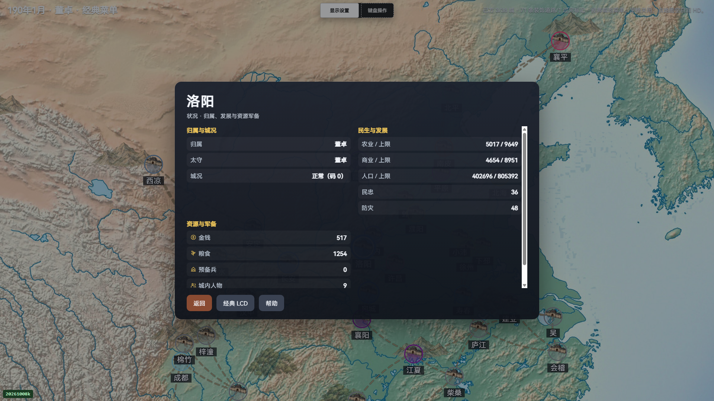
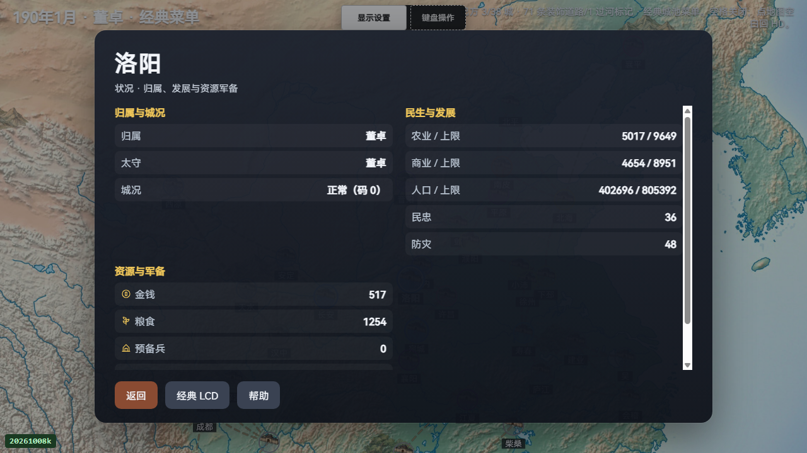
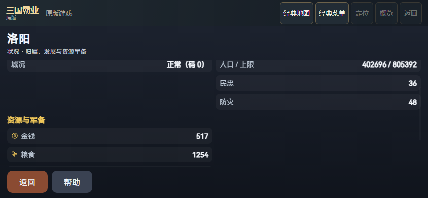

# 原版城池资源图标：PC完成，手机部分验证

五项资源增加装饰性SVG，保留中文、原生数值、字段顺序和无SVG文字回退。当前限定接受PC1920×1080与1280×720两布局：10行资源、6张装备卡／36字段，均由原生world、DOM、真实滚动与几何记录重新核对。资源／卡片读取与滚动、资源页本地返回均零原生键与LCD触摸；新局及菜单导航另有真实输入记录。

手机两轮均整体失败，原exit1／accepted=false保持。两轮各在模拟844×390成功读取五项资源后，v1人物焦点超时，v2显式属性翻页ACK超时；667×375均未执行。两次844资源观测分别保存，不能累加为两个设备布局，也不授手机完整装备或四布局验收。v2保留54次诊断call、零diagnosticErrors／drops，最后paint40、page4／start10／end12未推进；export调用返回不等于C消费ACK，未诊断丢失原因或证实队列溢出。下一批继续查原生消息消费与publication边界，不用重试假装修复。

首轮私有发布因读回器将target-before包裹对象误当数组而拒收（dce178／1），尚未写出公开包。原失败工具、原reader／publisher／binding作为固定原字节保留；新版本只修该小收据形状校验，原before完整字段不删。

本批新HUD190／190；旧epoch另有HUD190记录，两者不相加。两个新DOM用例为190子集。spec记录器首失败保留，未观察到产品断言失败。默认7907／149仅引用V67已保存基线，本批未重跑完整默认。

两份完整失败原mobile JSON与全部原phase PNG分别保存。v1为47031545字节／两块，v2为31205001字节／一块；每块都在原32MiB文件限额内，全部V45八项codec限额保持。完整count／ordinal／offset／size／SHA及两整件SHA核对后才解析JSON，未知原字段完整保留，无投影、截断或嵌套压缩。verify.accepted=true只表示材料完整可复核；mobileAccepted=false、globalHdComplete=false。

生产JS／CSS、页面与PC源未因诊断改变；仅mobile测试工具变化，旧before字节与新旧epoch/HUD保留。两失败局均来源稳定、无JS异常且自有浏览器退出／私端口关闭／profile保留，清理成功不等于功能验收。主P57与旧held不接入、不读取、不改动；无LOAD／SAVE／END／March／收入／战斗业务操作。本批不授完整ABI、packedSAVE、历史RNG、真机、性能、云服务或完整HD验收。
