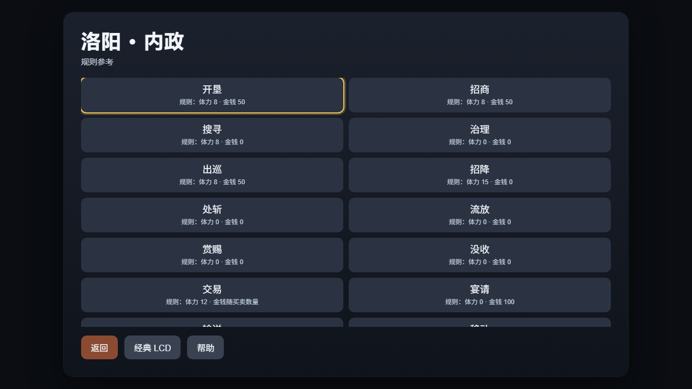

# 内政菜单消耗规则提示（V84，轻量开发验证）

2026-10-26，PC／手机内政的 14 项菜单新增体力、金钱规则参考。固定费用显示数值，交易说明金钱随买卖数量，输送说明运送物资另计；移动在旧兼容分支分别显示体力检查与消耗。按钮原名、顺序、点击委托与原生确认保持。

规则从当前原版 LIB 的 IFACE 消耗表和引擎配置读取，按实际 C 分支取值：治理使用第 0 项；招降的金钱仅在 fixConsumeMoney 非零时扣除；处斩／流放／赏赐／没收没有这两项扣除；宴请仅扣金钱。移动检查第 14 项，fixThewOverFlow 非零时扣第 14 项，否则扣第 13 项。U8 配置的所有非零值采用原生语义，金钱表兼容 U16LE。

仅当前己方城、原版身份、完整 CITY SUB 14 项名称与原始菜单镜像一致时显示；三次捕获核对菜单、来源、引用、配置与 hook。自定义可执行 hook 除精确内部空哨兵外撤回提示，读取不执行 hook。普通 PERSON 发布没有当前命令字段，因此本批只展示菜单规则参考，不把当前人物或调试模式推断为可执行／资源足够，不加红色不足判断或禁用。

最终两个相关模块新跑 **735/735**，净新增 4 组，失败／取消／跳过／todo 均 0，20 件所选来源保持。覆盖 14 项分支、0 号费用、未使用表项、非零配置、U16 金钱、输入委托、稳定节点、末次来源漂移、重入与失效撤回。首轮 734 通过／1 失败发现 PC 普通轮询未刷新失效提示，补齐 SUB 刷新后通过；中间通过轮次不重复计入最终总数。原失败日志保留。

两端各一次最终受控布局检查并视检通过，采用实际生产 SUB renderer、实际原版 LIB 与模拟菜单／配置，没有启动游戏。DOM 测量分别为 1264×625／651×280，PNG 输出为 1280×720／667×375；列表可滚动、返回可见，无横向溢出。带说明按钮至少 64px，逐项核对名称与说明均在按钮内且不相交。手机截图滚到列表底部，上沿的半行是滚动裁切。

此前隔离布局脚本有两次绑定／入口标签断言错误，仅各启动一个 PC Chrome；修正脚本后第三轮自动几何检查通过，但视检发现移动说明溢出。已增高带说明按钮并补文字包含检查，最终第四轮通过。六次自有 Chrome 均退出，全部早期原件与真假边界保留，未覆盖或重涂记录。

复核命令：

    node --test --test-reporter=tap --test-concurrency=1 scripts/test-hd-city-hud.mjs scripts/test-hd-city-mobile-host.mjs

[结构化记录](./m5-city-rules-20261026-v84.json)保存来源、日志和截图 SHA；本地原件位于 build/city-rules-20261026-v84/。本批无 C／WASM 修改或编译，未做实际内政下单、完整游戏流程、真机、性能或全量回归。旧战局未接入、关闭或重开；整体 HD 仍 partial。
