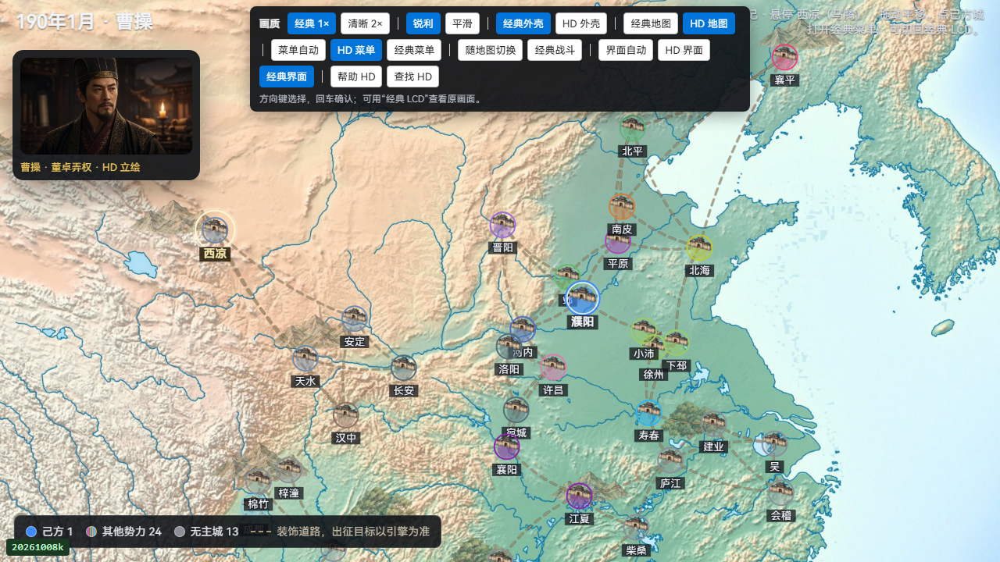
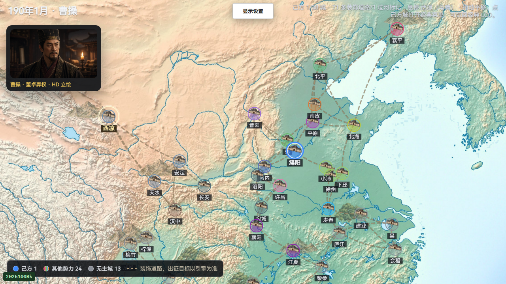
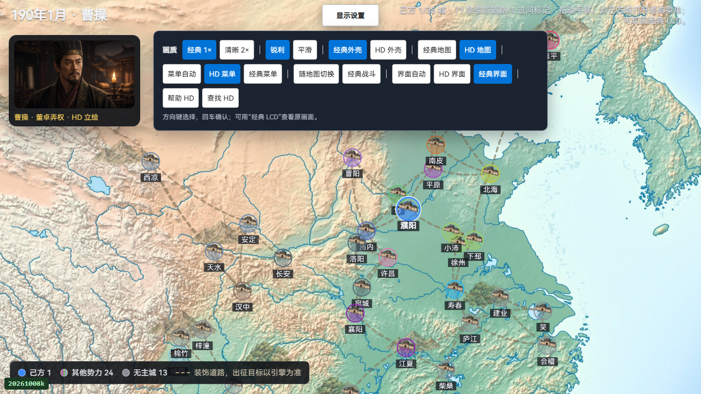

# PC 显示设置与顶部 HUD

2026-10-23。PC 地图上的完整显示工具栏原先固定覆盖顶部状态文字；现改为居中的“显示设置”入口，展开独立面板。原18个画质、地图、菜单、战斗、界面、帮助和查找按钮保留原行为。HUD 两侧为入口预留空间，设置面板支持键盘、Escape、外点和失焦关闭。

设置展开期间的按键隔离持续到对应 keyup，避免收起或进入帮助后泄露长按回车。收起后普通游戏键盘恢复。帮助／查找仍先请求原生发布；仅实际帮助渲染后才交接焦点，且不抢走用户随后选择的其他控件。没有修改 C、LIB 或重编 WASM。

## 本轮新鲜验证

- 隔离 Chrome、真实原版 LIB／已安装 WASM、时期一曹操开局；1920×1080、1280×720、1024×768，DPR1。鼠标和键盘由可信 CDP 输入驱动。
- 三尺寸均核对实际 HUD 文本 Range 与入口无重叠、全部18个设置按钮可见且可点击、Escape 回焦、Enter／Space 原生激活和 Tab 循环。实际切换缩放、滤镜、外壳、地图、菜单、战斗和系统界面全部选项。
- 纯显示设置阶段发送游戏按键0次，`bridgeWorldExpression` 的全部已采字段逐项相等。此合同包括人物、城池、订单、居民队列、日期及当前控制上下文，不等同 RNG、完整配置或整块内存相等。
- 单独核对帮助和查找原生交接：各一次请求及一次 Escape，合计4个原生按键；按住 Enter 的重复事件未误确认新帮助。最后另发一次正常游戏方向键，证明收起入口保留焦点时游戏键盘已恢复。以上5个有意游戏按键不计入显示设置的零输入口径。
- 122个默认登记测试文件串行执行，Node 汇总 **6595／6595**；失败、取消、跳过、todo均0，包含实际 C 编译执行。该总数已包含显示设置6项和V32正式307项，不再相加。
- 最终浏览器记录无未捕获异常或意外弹框，所冻结的浏览器来源无漂移；私有浏览器根进程退出、资料目录删除、HTTP／调试端口关闭。没有触碰239-3战役双SAVE。

首轮全套因没有名为`cc`的默认编译器而有447项失败，全部错误均为`spawn cc ENOENT`；6148项通过。确认现有Clang 18可编译并执行本机探针后，指定`CC=build/toolchain/emsdk/upstream/bin/clang.exe`重跑全部122文件，得到上述6595项通过。初次UI检查的CDP缺少字符事件、首次旧版观察器的Windows路径分隔符问题和该编译器失败日志均在本地保留；最终收据列出其精确哈希，没有将这些运行改写为成功。

## 前后画面与来源

旧版来源固定为提交`37b10dcecca90cbc244fbef3daa3eeaec60284ac`的五个PC产品文件，另开隔离新局观察，三个尺寸均实际复现工具栏与HUD重叠。该观察没有载入或回退最新战役。

| 720p旧版 | 720p收起后 |
| --- | --- |
|  |  |

[收据及精确文件清单](m5-display-settings-20261023/receipt.json)保存原始浏览器报告、前后来源核对、完整成功回归日志及代表截图；较早失败原件仍在本地build，`portableClosedArchive=false`。维护入口为`node scripts/test-hd-overworld-runtime.mjs --display-settings-only --artifact-dir <新的build子目录>`；单元入口为`npm run test:display-settings`。全套需明确设置上述`CC`后运行`node --test --test-concurrency=1`及package中全部文件。

本批仅接受已列PC时期一显示设置、帮助／查找交接范围。没有跑完整38城战役、其他时期、战场设置矩阵、真实手机、性能或云服务；没有新增撞击施放或经典LCD验收。完整HD继续partial，战役后续见[239-3续接审计](m5-impact13-continuation-20261023.md)。
