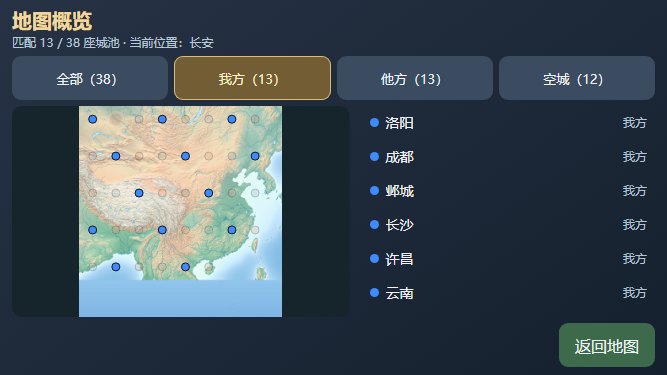

# 地图概览城池筛选（V75，轻量开发验证）

2026-10-26，原版 PC 和手机“地图概览”增加全部／我方／他方／空城四个本地筛选按钮，显示各类数量及“匹配 n / 38”。列表仅列匹配城，地图保留全图并淡化其它城点；当前游标城市提示与位置不变。unknown 仍保留在全部中，不被误归为他方或空城。

仅使用既有授权概览快照，不新增世界读取、选城、游标移动或原生查找能力。筛选会退休旧返回按压／抬起票据；原生 owner 与已提交状态保持，新的明确返回仍只发送一次40。经典回退禁用／隐藏筛选，关闭和原生新概览重置为全部。普通按钮支持键盘激活，不让筛选键误退原生小地图。

相关两个模块新跑 **154/154**（地图控制器90＋手机host64），净新增4个默认测试，10件所选来源前后保持。覆盖PC／手机分类与未知归属、零匹配、城点淡化、当前游标保持、旧返回按压撤销、一次返回、回退／重开及键盘归属；并行静审通过。原始TAP保留在本地 build/minimap-filters-20261026-v75/targeted-v1.stdout.tap，结构化记录保存其SHA。

另做一次受控窄屏布局烟检：4按钮高44px，内容区可见、无横向溢出、筛选零游戏键；任务自有Chrome正常退出，profile保留。DOM初始测量651×280，PNG输出667×375，分别记录；图片中的城池为模拟数据，不是实际游戏流程。该烟检后仅收窄键盘拦截分支，视觉结构及样式未改。

复核命令：

    node --test --test-reporter=tap --test-concurrency=1 scripts/test-hd-minimap.mjs scripts/test-hd-mobile-minimap.mjs

[结构化记录](./m5-minimap-filters-20261026-v75.json)。本批不跑全量或游戏矩阵、不制作新归档包，真机与性能后续安排。C／WASM和旧战局未改；整体HD仍partial。
