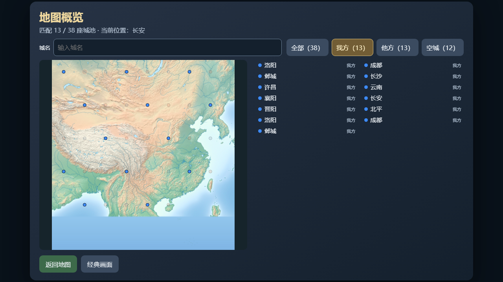
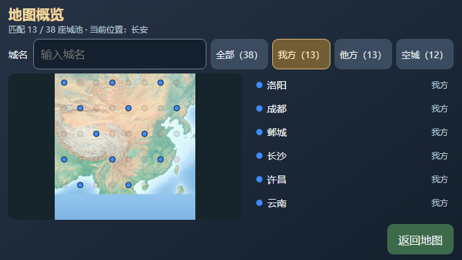

# 地图概览城名查找（V82，轻量开发验证）

2026-10-26，原版 PC／手机地图概览增加城名输入框，与全部／我方／他方／空城筛选组合。对已授权的 38 城名称做去两端空白、大小写无关的字面子串匹配；名单、匹配数和地图点位淡化共用同一条件。归属按钮仍显示各自总数，当前位置与原生游标保持。输入最多 32 个浏览器 maxlength 单位，无新原生 SEARCH、方向键或城市定位操作。

输入框保留方向键、数字、空格、Enter、Escape、Tab及中文输入法的默认编辑行为，阻止其传播到游戏；Enter不关闭概览。组合输入期间不提交查找，可信 compositionend 才采用最终文字。普通轮询保留当前输入、光标选区和列表滚动；离开输入框只退休未完成的编辑，已提交查找词保留，便于点击归属筛选。

编辑绑定当前输入框、焦点及概览 owner／表现 epoch／来源。关闭、窗口失焦、隐藏、换代、来源变化或进入经典显示时清空查找，旧组合结束和随后 input 不能迁移到新来源。每次查找变化取消旧 Return 按压与授权，但不清同 owner 已提交的单次退出。有效编辑中的滚动／resize 保留查找与 IME 本地票，只取消旧 Return；非编辑手机 resize 继续原退休流程。PC与手机原有经典回退恢复方式保持各自合同。

两个相关模块最终新跑 **158/158**，净新增 4 组，失败／取消／跳过／todo 均 0，11 件所选来源保持。覆盖中文／英文／空白／特殊字符的字面匹配、归属组合、输入隔离、可信与伪造事件、IME、旧按压／UP授权、来源／owner／生命周期、保留编辑及 fresh Return 一次；查找与编辑期间零原生键／零世界写入，显式返回另核一次 EXIT。前三次 false 原件保留：首轮暴露 PC 滚动未退休旧返回，并有输入框 blur 清词的错误预期；后两轮分别校正 PC 与手机不同的经典回退恢复预期。未把测试预期改成自动退出经典，也未扩大原生输入权限。

PC／手机各一次受控 DOM／CSS 检查通过：输入与归属按钮同排，字体 16px、操作高度至少 44px，列表／地图和返回按钮完整，无横向溢出。初始 DOM 为 1264×625／651×280，PNG 为 1280×720／667×375，分别记录。采用模拟城池数据及实际概览控制器，无真实游戏或可信浏览器文字输入；两次自有 Chrome 正常退出。布局执行采用 PC 滚动修复前候选，后续仅该事件退休行为变化，CSS及入口字节保持。

复核命令：

    node --test --test-reporter=tap --test-concurrency=1 scripts/test-hd-minimap.mjs scripts/test-hd-mobile-minimap.mjs

[结构化记录](./m5-minimap-search-20261026-v82.json)保存来源与日志 SHA；本地原件位于 build/minimap-search-20261026-v82/。本批无 C／WASM 改动，无实际游戏、手机软键盘、真机或全量接受；完整流程和调优后排。旧战局未接入、关闭或重开，整体 HD 仍 partial。
