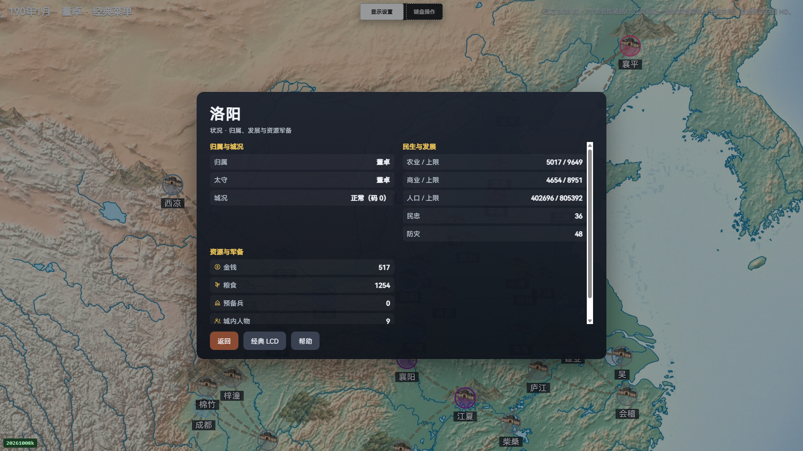
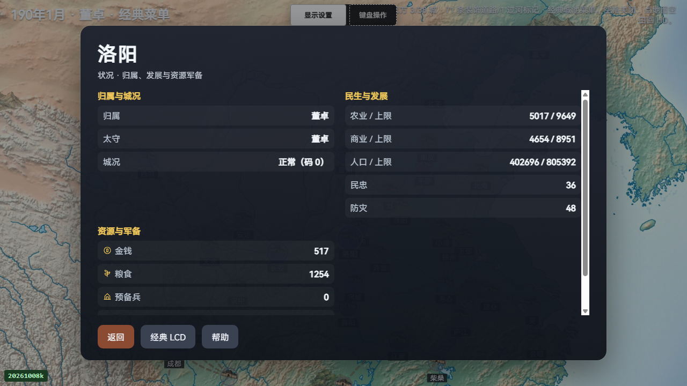
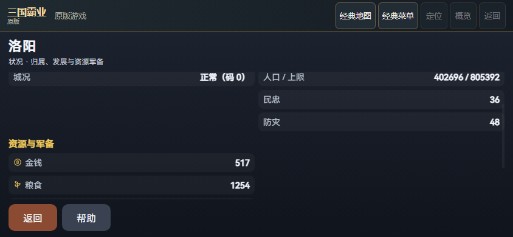
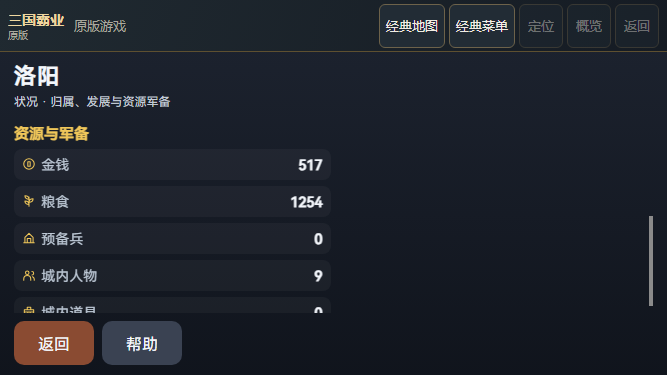

# 原生消息队列同步 credit 修复与实际验证

首版private／disk数据读回通过，独立公开CLI随后因portable源码转换改写自身literal而拒收（49fcda／1）。原游戏／默认测试结果不变，首版完整public原件本地保存；新包另存原CLI失败与logs、private／disk收据、旧六公开模块／canonical／binding／sourcefreeze和九份原源码，旧全parts仅本地保留。本次只将portable转换限制到真正顶层import行，不再改函数体literal；未重跑或回填游戏验收。

原 sem 在队列已有 credit 时仍安排异步 wake；本批仅将该分支改为减一次 credit 后同步 wake，空队列保持原异步回调。正式 sem 独立归一LF，并以官方StageOnly生成且逐字节安装四件引擎，七入口缓存同步到20261026sem1。当前153关键来源含128原生源，整件与manifest aggregate重核；完整默认1645来源只保留原before／TAP／receipt证据，不称本读回器重验全部1645当前文件。

本轮旧引擎真实手机失败与完整原件保持：最后UP前后同步观察sem0为99／signal-null→99／signal-null；C池达到100拒入队是有明确单线程／单消费者前提的源码推导，没有直接读到C cur／drop计数，也不倒推V68。修复后同公开手机流程844×390与667×375完成，202calls／1063events，诊断drops／errors均0，已测sem0范围0..2；这些计数不是精确队列深度或所有性能原因的证明。

PC1920×1080／1280×720与两模拟手机布局实际闭合，资源20行、装备12卡／72字段由完整原生world、原ROM、DOM与滚动几何重新核对。检查时零原生键／LCD触摸且已测world/native不变；新局、导航和返回另存实际按键。当前PC各1221来源、手机after73（只多486B李儒头像，五处引擎安装相关来源变化）、before72严格分列。全新默认7913／7913、150文件；本批四项原生测试和此前两项HUD新增只计一次。VM候选4／4与旧1pass／3fail、whole-gui WASM probe old/new、首次missing-header编译失败及原日志完整保存。

额外原标题MAKER三场限定原生LCD回归：96／9／96逻辑帧，3／4／4键，前两自然返回仅接受实际观察≥45秒的宽限，不授精确5000tick、全SPE、HD或性能信用。418张原PNG（402capture＋15phase＋1native参考）及完整top／三observations保留；SHA相同别名在原限额内共同分包，所有原路径完整。OS只归档任务范围9580字节退出收据与已执行inline监测input文本；含无关进程命令行的全OS CIM原件保留本地，仅引用原hash，不随Git归档、不称whole-CIM离线重构。

两份完整手机JSON先以原32MiB raw ranges核整件SHA再解析，未知字段完整保留。Maker／core原件先以保守unique32MiB、named96MiB、450files分包并测最坏serialized预算，全部V45八项限额保持。共享SDK缓存只接受1928条path／size／time元数据与335字节cfg raw匹配，不称全缓存字节哈希。

没有接入P57或旧held，没有战役LOAD／SAVE／END／March业务输入。真实同会话WOOD／AID、完整ABI、packed SAVE、历史RNG、真机、稳定性能、云服务及整体HD继续partial。
