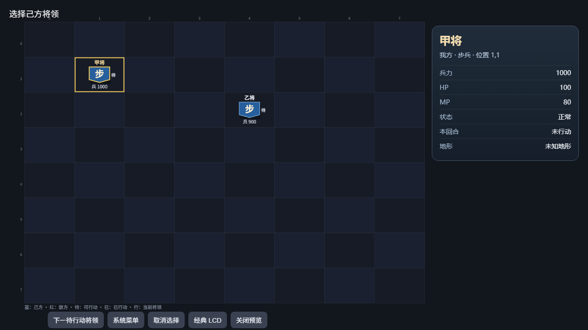
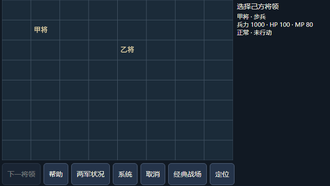
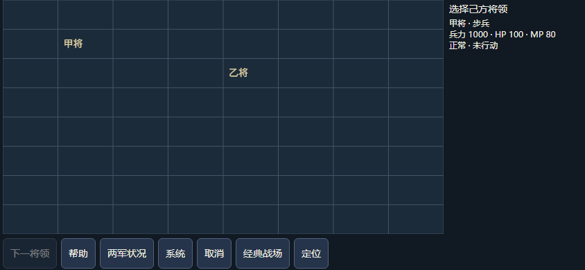

# 下一待行动将领入口（V87，轻量开发验证）

2026-10-26，PC新增“下一待行动将领”，手机新增“下一将领”。仅原生选将PICK等待阶段可用；从当前己方焦点槽之后循环查找，空格／敌方焦点从首名开始。沿原名单0..9保序，跳过已行动、混乱、石阵和死亡，不因HP／MP／兵力为0增加原版没有的限制；同格服从首槽裁决，坐标核原始地图边界，避免误用扩展视觉尺寸。

点击沿既有tile事务逐个方向键等待真实光标ACK，到达目标后只确认一次。目的地刷新仍须对应原槽与人物ID，替换或退休后不确认。PC鼠标按下票绑定当前owner／焦点／候选／几何／来源引用及表现代次，边界退休旧按下；原生键盘激活走当前可用性。手机沿现有可信pointer与opaque原生票，抬起和共享方法再次复核。不新增原生控制字段，不自动选将、结束行动或回合；旧clickOwnUnit首名语义保持。非PICK、报告、HELP／VIEW、经典、LCD、隐藏、预览、等待事务或无候选时禁用。手机页脚保留44px按钮并允许必要时横滚。

四个相关模块最终新跑 **303/303**，净新增9组（commands5、手机pointer3、共享mobile票1），失败／取消／跳过／todo均0，23件所选来源保持。覆盖循环／回绕／稀疏槽、状态与零值、同格／越界、旧按下与旧手机票、阻挡状态、逐ACK及唯一ENTER、目的地人物／槽替换、空闲零键和新增路径零世界写入。三个先行模块60／156／48项均包含在303中，不重复相加；这些是完整JS模块配模拟原生回执，不是游戏实跑或物理可信事件。

三次最终受控布局检查并视检通过：PC1280×720、手机667×375及844×390。使用实际入口／CSS与完整共享模块，手机绘制宿主为受控替身，没有启动游戏。新按钮与页脚可见、无横向页面溢出，手机七按钮均至少44px。DOM测量1264×625／651×280／828×295与PNG尺寸分别记录。截图只证明排布；手机截图捕获时控件呈暗色，启用DOM度量与VM票据检查另列，不授该图时刻真实可点信用。

保留三次新增用例错误摘要：跳过方向ACK、误序列化opaque根对象、断言未导出调试字段；均修正用例而未为失败改产品。初版布局手机未产出度量，后续明确观察当前受控战场并修正测量时机；总计八个自有Chrome均退出。m.html曾被用户映射区域占用而不能原地写入，已保存原字节后用同目录原子替换仅更新CSS缓存标记，无进程干预。

复核命令：

    node --test --test-reporter=tap --test-concurrency=1 scripts/test-hd-battle-commands.mjs scripts/test-hd-battle-mobile-host.mjs scripts/test-hd-mobile-battle.mjs scripts/test-hd-render-visibility.mjs

[结构化记录](./m5-next-unit-20261026-v87.json)保存来源、TAP与截图SHA及失败摘要；本地原件位于 build/next-unit-20261026-v87/。本批无C／WASM修改或编译，未做真实选将、完整战役、真机、性能或全量回归。旧战局未接入、关闭或重开；实际流程和全量调优后排，整体HD仍partial。

暂存字节核对发现原手机模块与其测试为混合换行，已保存原件并统一LF、固定文件属性；规范化文本逐字相同。最终303项在规范化后的23件来源上重跑通过，前一轮303项不重复计数。
