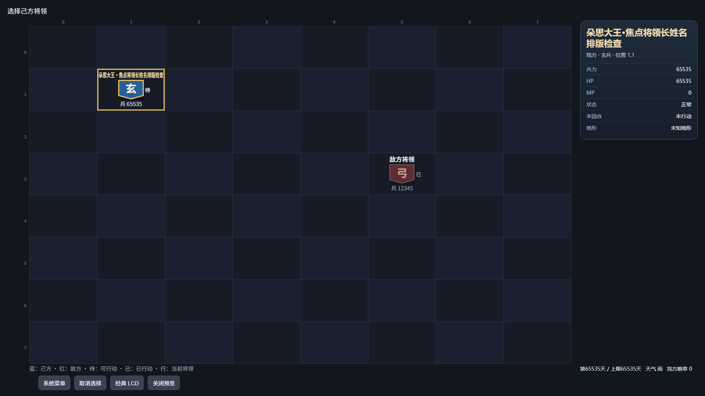
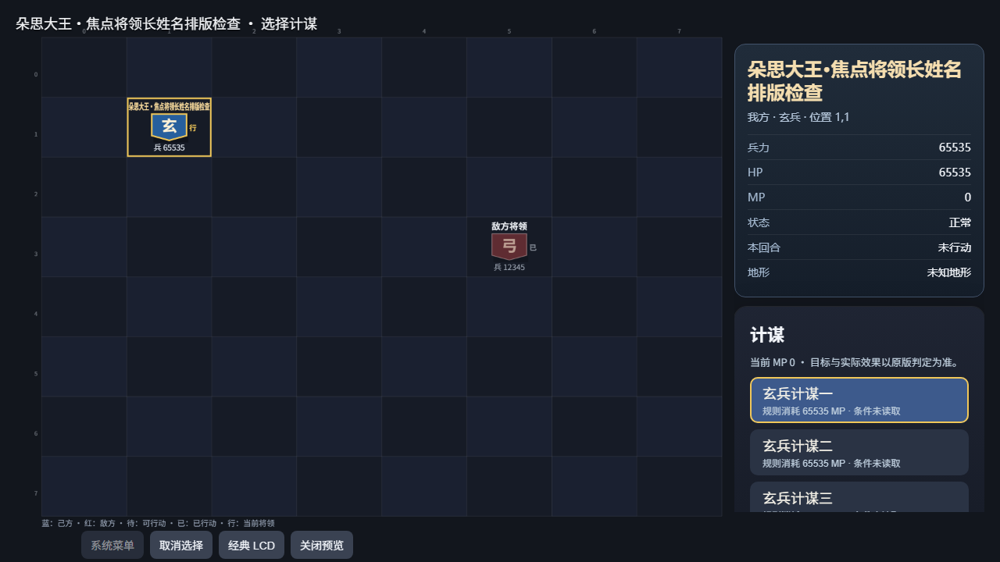
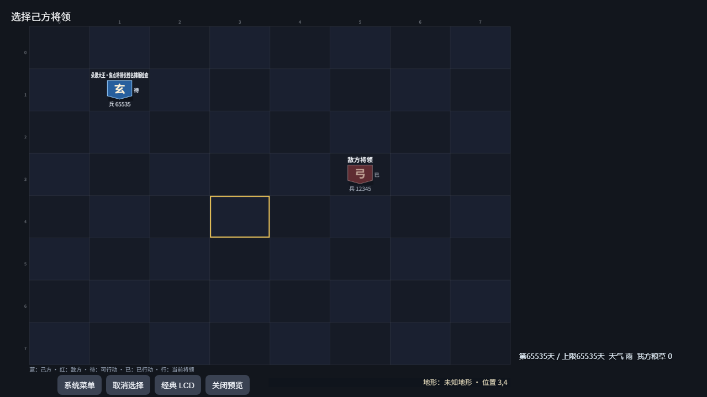

# PC 战场焦点信息卡（V86，轻量开发验证）

2026-10-26，PC 将原画布底部的将领长串改为右侧 DOM 信息卡，完整显示姓名、阵营、兵种、原生坐标，分行展示兵力、HP、MP、状态、本回合行动标志与地形。HP／MP 保留原 U16 数值与0，不假定100上限；“未行动”只表示 active=0，不推断该将可选或可施放。特殊姓名用 textContent 保真，未知字段继续标未知。

卡片复用现有 sampleFight／state.units 与当前焦点，不新增原生字段、读取或独立身份保证；原采样及未知 LIB 的边界保持，不把这次 DOM 改造当作新来源认证。手机已有独立 DOM 详情，本批不改其展示。空格与死亡焦点撤卡，空格原地形提示保留；报告、HELP／VIEW、非就绪、战斗结束、隐藏、经典、LCD、预览及关闭均清旧卡。稳定内容保留节点，不增加按钮或原生输入。

右栏容纳焦点卡、既有菜单及天气／粮草／天数，短窗口可滚动。棋盘右边缘按实际侧栏矩形留出24设计像素，绘制与 eventToTile 共用同一个几何函数，侧栏不会盖住格子；无侧栏的旧入口和预览保留原几何。既有目标预览文字继续显示，输入范围与引擎规则保持。

四个相关模块最终新跑 **294/294**，净新增5组，失败／取消／跳过／todo均0，20件所选来源保持。覆盖特殊完整姓名、我敌身份、0及65535、未知值、状态／行动分开、生命周期清理、稳定节点、零输入／世界保持，以及由实际绘制首格反算点击后选到原生(4,2)的坐标一致性；只有显式画布点击发出原有首个方向键，卡区点击不发键。此前 commands 单模块55项已包含于294项，不重复累加。未跑全量或C编译。

最终三次受控布局并视检通过：宽屏焦点卡、短窗口完整十项计谋提示、短窗口空格焦点。完整生产 battle 模块运行在模拟原生快照上，没有启动游戏；卡片文字包含、棋盘右界、侧栏／菜单滚动及页脚可见均检查，空格地形与页脚没有重叠。DOM测量为1904×985／1264×625，PNG为1920×1080／1280×720，分别保存。此前两次布局已通过，但短窗口只有普通菜单（模拟提示DTO缺少owner字段）；最终补齐模拟owner并增加空格检查，产品源没有因此修改。总共五个自有Chrome均退出。

复核命令：

    node --test --test-reporter=tap --test-concurrency=1 scripts/test-hd-battle-commands.mjs scripts/test-hd-battle-mobile-host.mjs scripts/test-hd-mobile-battle.mjs scripts/test-hd-render-visibility.mjs

[结构化记录](./m5-pc-focus-card-20261026-v86.json)保存来源、日志及截图SHA，本地原件位于 build/pc-focus-card-20261026-v86/。本批没有实际战役操作、真机或性能信用，无C／WASM修改。旧战局未接入、关闭或重开；实际流程、全量验证与调优后排，整体HD仍partial。
