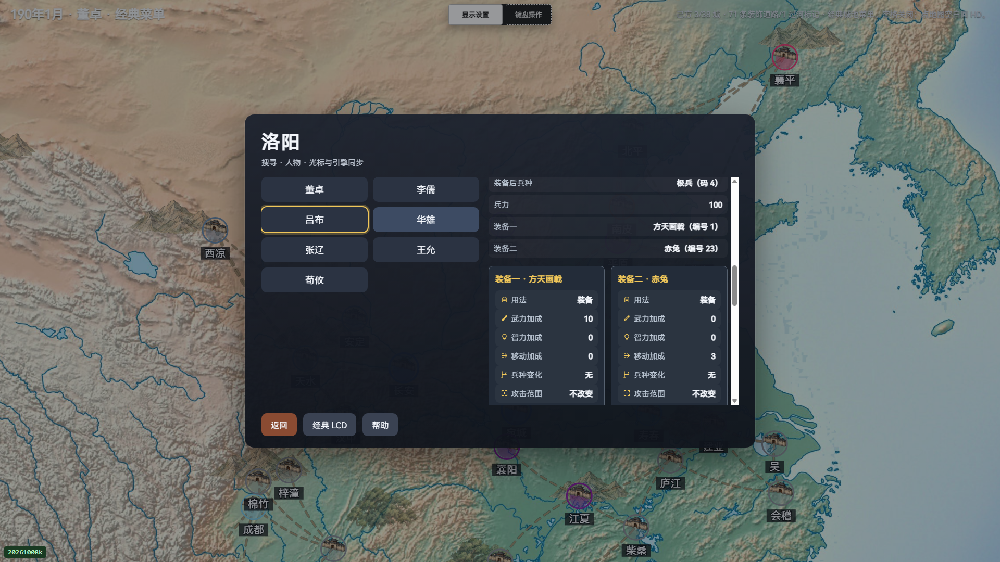
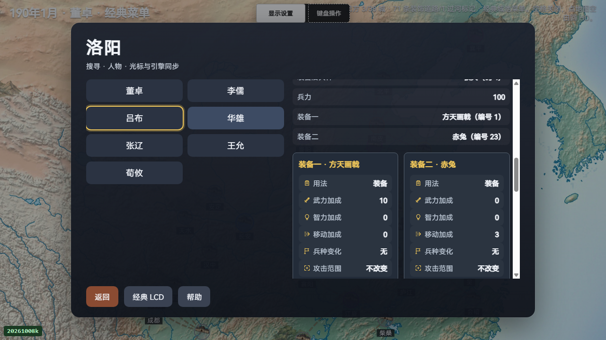
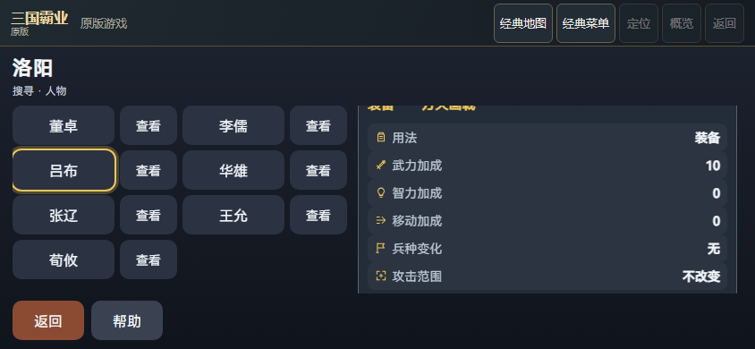
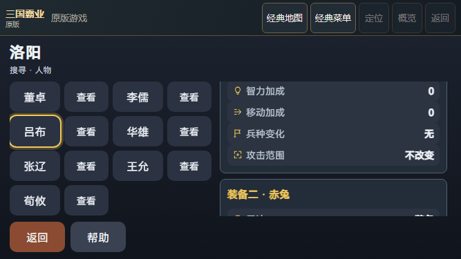

# 原版人物装备语义图标

六个已知装备字段增加装饰性SVG，原中文标签、ROM数值与未知／无SVG文字回退保持。完整默认7907／7907、149文件，新默认仅2项；HUD188为专项子集，原186旧代码记录不授图标信用。

PC1920×1080／1280×720、模拟横屏844×390／667×375均核对吕布双装备、董卓单装备和李儒空装备，共12卡／72字段。卡片读取／滚动0原生键、0LCD触摸，已采native/world前后相等。SVG可访问性、实际viewport、1em、包含／无重叠／无横向溢出由保存记录重推。新局与菜单导航按键另行保留，整次流程并非零输入。

完整原mobile result为142291141字节。四块32MiB与末块8073413字节各置独立V45 packet，core保存其它原件。各packet的单文件／unique／named／serialized限额均保持原值；按ordinal和offset无缺重跳地复原全字节，核原整件SHA后才JSON解析，所有未知字段保留。不是截断、投影或嵌套gzip。公开reader不直接读取超限公共文件。

三私有浏览器清理与来源稳定必须通过。preflight-v1为1次失败，preflight-v2为1次成功的仅预检，两者accepted=false且不授装备运行信用。原full-v1为7906／7907、1失败；原四件及工具终态保留。随后仅两文件CRLF归一到既有HEAD字节、追加两条LF属性，0断言／逻辑变化，专项16／16不重复计入默认；本页7907／7907仅来自独立full-v2。四布局浏览器记录保持修复前原件，未因LF修复重跑。checkout修复及旧186日志完整保留。1638条原before向量／原TAP／receipt归档，当前只核18个关键文件而非逐件重验全部1638。主P57与旧held不接入、不读取、不改动，无LOAD／SAVE／END／March／收入／战斗业务操作；完整ABI、packed SAVE、历史RNG、物理手机、云服务、完整HD不在验收内，globalHdComplete=false。
