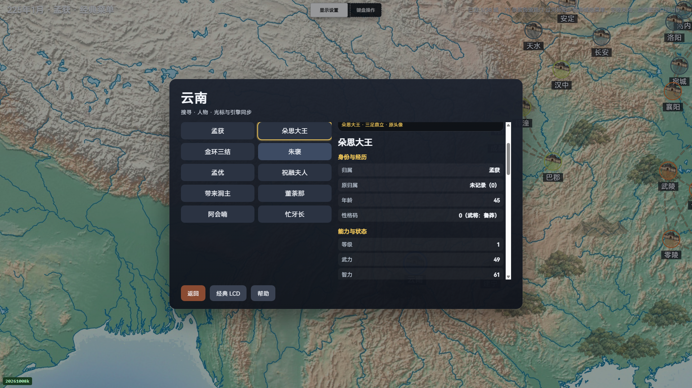
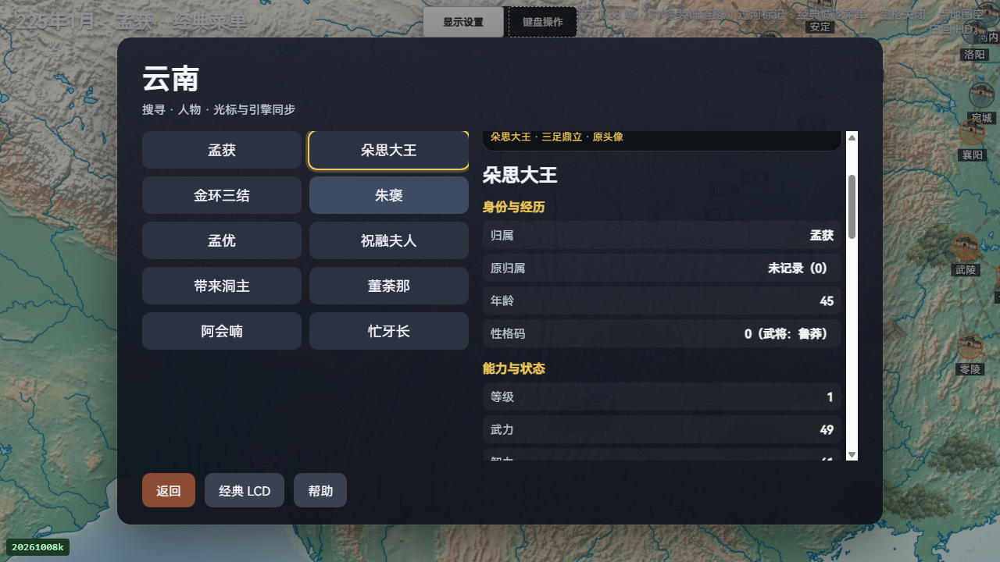
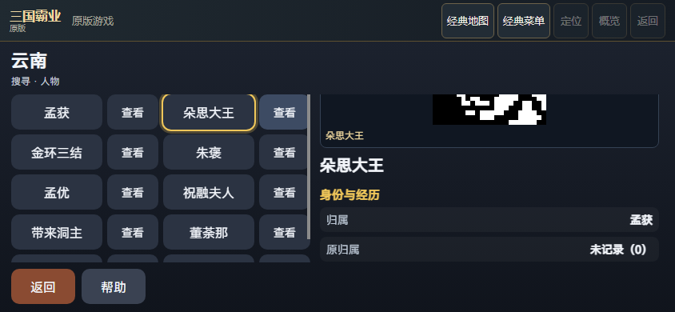
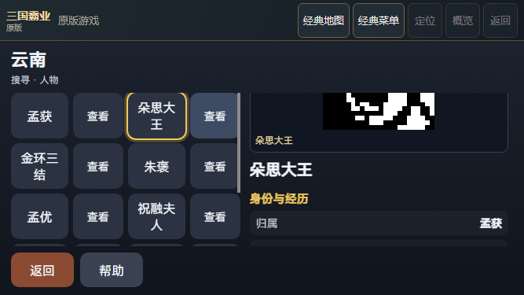

# 原版 P4 人物姓名与归属实际验证

D1原prepare36b3b4／1曾将当前156关键清单误当作全属于runtime1225冻结清单，在chunks／draft写出前拒收；D2完整保存原五份源码／freeze／peer／raw终态，修为精确145交集与11差集，当前156全字节guard不变。

原版全 ROM 实际最长姓名为四字。本批新局选择 P4 孟获／云南，四布局各检查孟获、朵思大王、金环三结、祝融夫人、带来洞主，共20次身份检查、100个列表／姓名／归属／原归属／原生归属目标。文字、Range、祖先裁切、命中、原始截图以及检查前后完整已测world/native和零键／LCD触摸均独立读回；原packed八字节槽损半字仍完整保留，只用当前原生ID与原ROM全名作期望。原生归属仅当前第一页第0属性，不授全部13列实际验收。

首轮地图目标在视口外、第二轮误等待多层返回，所有原CLI exit1及完整false报告、失败图、所有阶段图和执行副本保持原样。原手机版入口时间戳守卫、控件短暂未shown及非交互panband不足的原失败也完整保留。控制器随后用可信物理拖动露出云南，并按真实原生PERSON的单次EXIT40直接返回MAP合同验收；这些是维护运行器修正，产品JS／C／引擎未改。新四布局完整闭合；各轮1225项冻结清单各自稳定，其中145项与156项当前关键清单相交，另11项旧入口／旧脚本未纳入此运行器；差集路径和数量逐轮精确核对。冻结清单不等于每项均实际HTTP访问或执行。156项当前关键文件仍逐字节重核，128原生整件aggregate重核。模拟手机属于Chrome尺寸模拟，不授真机或稳定性能信用。

全部完整报告以原32MiB raw ranges保存，先核整件SHA再解析；未知字段原样保留。全部阶段PNG、执行副本、源码核对与原CLI终态均收录。预检旧21928字节helper与修正后的22262字节原件分别保留；预检是未调用身份函数的nogame检查，acceptedfalse，不能转作实玩成功。使用原V45 codec八项限额，未执行归档源码。

V69 7913／7913、150模块仅为固定保存的父基线，本轮未新增默认测试或重跑全量。用户已明确保留旧战局、暂不重开并继续其他HD；本轮没有旧战局输入或关闭授权。俘虏／在野／敌方实际访问、任意Mod长名、其他期实玩、完整ABI／SAVE／RNG、真机、稳定性能及整体HD仍未验收。
