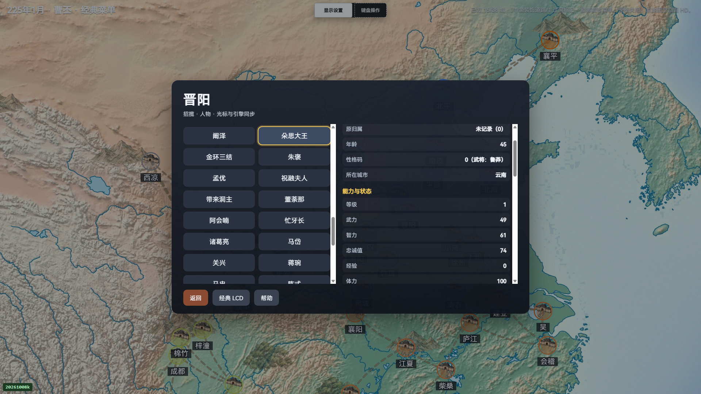
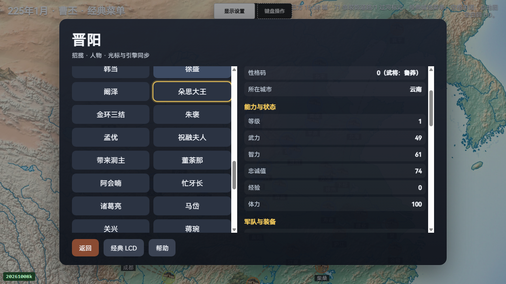
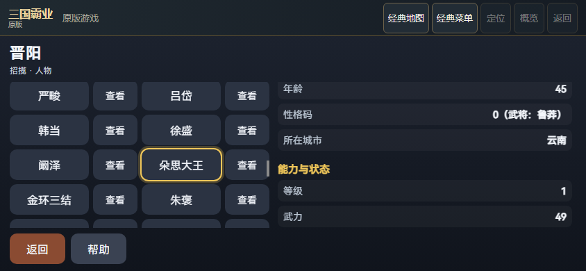
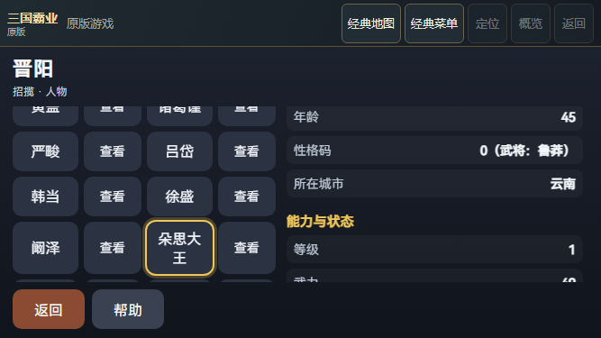

# 原版人物所在城市与原生属性1验证

本批在原版当前 PERSON 详情的“身份与经历”增加只读“所在城市”。来源严格采用 C GetPersonCity 的城0..37、各城完整队列顺序及首次匹配，不用菜单起始城或人物归属猜位置；重复记录保留首城／首偏移。逻辑人物200与原生物理人物绑定2000分别验证，城市绑定38、队列2000；未知库、自定义属性、无匹配255、损坏范围、来源漂移及 getter 重入都不显示该行。未新增原生导出、属性hook重放、原生输入或world写入；原15项诊断字段与自定义原生语义保持。

四个任务专属真实原版P4曹丕／晋阳新局，PC1080／PC720／模拟844／模拟667均检查崔琰29在晋阳4，以及朵思大王139、祝融夫人143在云南30。位置同时与原ROM队列、当前完整城池队列的首次匹配及实际翻到的原生属性1逐项一致。原生标题完整保留空格“ 所在城市 ”。共12人次位置／24个HD与native目标，另有12人次既有身份／60个姓名归属目标；这些是浏览器观察，不是84项单元测试，也不是全部13属性验收。每人实际37前翻／36返回，四场合计24个属性分页键；每场仅一次执行者39，敌方目标确认0，再40／40按原生回执回MAP，无派发或月结。

每个位置目标保留完整文本、Range、祖先裁切、命中、标签值不重叠、当前ID／来源／代次和原始PNG。读取、截图及真实滚动零额外原生键／LCD触摸；分页除person属性画面外所有已采native字段保持，日期、config、200逻辑人物、38城池、队列、订单等全部已测world保持。模拟844／667各11／24次真实名单滚动；四场阶段25／25／39／52全部保存，自有Chrome树均退出。Chrome手机尺寸模拟不授真机或稳定性能信用。

旧73d7cfa产品的真实PC720新局在6阶段完成崔琰的既有身份观察，却没有HD位置行，原exit1、全部5个全局false、失败图及已接受的身份子记录均保留；不改成整场成功。修复后四布局均在同一冻结产品／运行器源码闭合，无事后attrs例外。完整5份报告使用原32MiB byte ranges，先重核整件长度／SHA，再解析；未知字段不投影、不丢弃。全部阶段图、9种执行副本、console、来源与owned-process原记录和CLI初始／终态均收录；归档代码是数据，验证器不执行它。

HUD受控模块202／202通过，其中12项新增。旧父产品190通过／12预期失败；隔离的无重入保护变体仅修正两个物理容量字面量，201通过／1预期失败；保留错误物理容量的旧候选190通过／12预期失败。底层负控exit1与确认负控有效的外层exit0分别保留。完整默认实际7943／7943、150模块、Clang18通过，fail／cancel／skip／todo均0，1650项选定来源运行前后稳定。202是全量子集，先前单独12项探针不重复加总。

当前159关键源码全部原字节核对，128份native整件aggregate仍为617c3aea391fa57bec1576e70cb6b4b1ed76f747c948015069a71f71b168ffb0，WASM未重建，原构建sourceRevision／modified标记保留。每场1227项冻结清单中147项与当前关键清单精确相交，12项差集逐项列明；冻结不表示每项都实际HTTP请求或执行。所有成功轮147项均等于最终当前原字节。V45八项限额不变，缺少本地build可由归档精确重构；本地原件存在但不一致则拒收。

用户已明确保留旧战局、暂不重开并继续其他HD；本批没有旧战局LOAD／SAVE／END、输入、关闭或清理。俘虏／在野实际访问、目标确认／派发／月结、其他期实玩、任意Mod、全部13属性、完整ABI／SAVE／RNG、真机、稳定性能及整体HD仍未验收。
