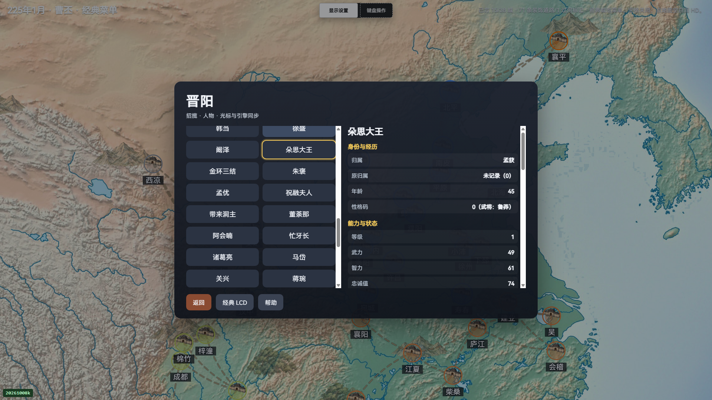
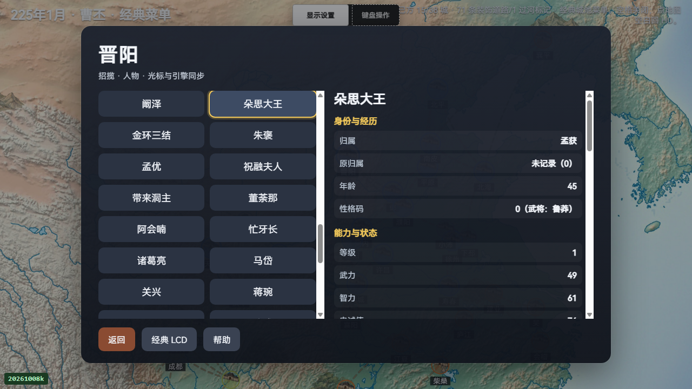
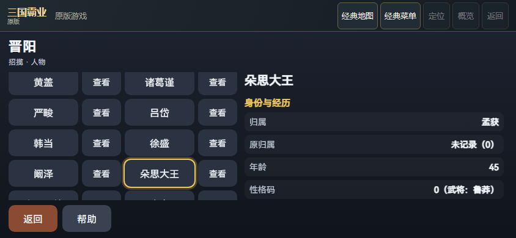
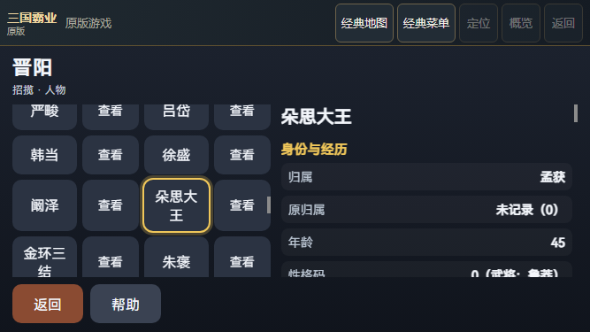

# 原版 P4 外交人物角色与 PC 返回修复

本批为 PC 接上原生外交的执行者／目标阶段，显示完整人物详情与当前角色，并按原生确认结果返回上一阶段。ENTER／EXIT 的一次发送保留在独立的原生角色记录中；异常或尚未收到 ACK 时，关闭面板及切换经典／HD 都不会重新授予同一次输入。PC 不取得手机版的公开输入票据。手机原有输入流程保留，并同步复验。

实际验证新开任务专属 P4 曹丕／晋阳新局，进入招揽 CANVASS16，检查己方执行者崔琰29，以及敌方朵思大王139、祝融夫人143。两名敌方人物的实际 Belong=4／君主孟获3，与玩家曹丕0不同；四字姓名是原版四期完整 ROM 的实际最长长度。PC1080、PC720、模拟手机844、模拟手机667各检查三人，共12次身份检查、60个列表全名／详情姓名／归属／原归属／原生归属目标。每个目标保存完整文本、Range、命中、祖先裁切、相邻元素及原始截图；身份检查本身零原生按键、零 LCD 触摸，并核对全部已测 world/native 字段不变。原生归属仅验当前第一页第0属性，不授全部13列实际验收。

每局仅确认执行者一次39以进入敌方目标名单，不确认任何目标，不派发命令。一次40从目标返回新执行者名单，再一次40退出到实际 MAP；原生 session、inputSeq、menuSeq、角色和地图 ACK 逐项绑定。所有已测日期、资源、人物、队列和命令记录保持不变。模拟手机通过实际触摸预览及非交互区域滑动阅读；844使用20次名单滑动，667使用13次，均核对零额外选择／确认、零原生 LCD 触摸及 world/native 不变。这是 Chrome 尺寸模拟，不能代替真机或稳定性能验收。

原 PC 产品8fd95a7的实际新局记录在外交执行者阶段缺少 HD 角色详情，完整 false 报告与失败图原样保留。新产品的第一次运行遇到原生状态先于 HD 采用，第二次遇到目标状态先于角色 DOM 更新；运行器随后等待真实的采用及 DOM 角色 ACK，产品448176字节／cfcd4f89保持不变。手机版844首次发生 Runtime.evaluate 超时，原因未确认，失败报告仍为 false，原本缺少的失败截图和 failureState 保持缺少。最终同一产品和12826字节运行辅助器分别闭合四个布局；全部8份原报告、4次失败、全部阶段图、执行副本、源码清单、控制器修正记录及原 CLI 终态均收录，不改写失败结果。

最终受控外交模块504／504通过。相同新测试针对最初 PC 候选触发3个预期失败，针对旧父产品触发18个预期失败；底层退出1与外层确认负控有效的退出0分别保留。旧500项及中间504项运行仅作原始记录，不重复计入默认全量或实际浏览器验收。

默认全量已实际关闭并通过7931／7931，150个已注册模块，fail／cancel／skip／todo均为0，1649项选定源码在运行前后逐字节稳定。使用原记录 Clang18；默认测试较保存的7913父基线新增18项，受控模块504项是全量的子集，浏览器12次身份／60个目标不计作单位测试。

当前关键清单158项，原生128份源码 aggregate 617c3aea391fa57bec1576e70cb6b4b1ed76f747c948015069a71f71b168ffb0；WASM 未重建，原构建 sourceRevision／modified 标记保留。各轮运行器冻结1226项，与当前关键清单的精确交集146项、差集12项分别核对；冻结清单不表示每项均被实际 HTTP 请求或执行。全部浏览器及默认全量关闭后，实际仅向 attrs 追加一条 Git 字节保留规则，使提交中的 CRLF 测试源码保留实际执行过的194102字节。整件旧42866字节加固定65字节后缀等于新42931字节；1649项全量源码向量只有 attrs 变化，157项其余关键源码以及所有执行代码／测试字节均保持原样。四个成功运行的146项交集中，145项直接等于最终当前字节，唯一 attrs 项绑定精确的前一 metadata 字节；12项差集原样列明。全量是在追加规则前运行，本批未声称在新 attrs 上再跑全量。最终158项当前文件仍必须逐字节核对；其他成功源码差异均拒收。

所有完整报告均以不压缩的32MiB原始 byte ranges重构，先核整件长度／SHA，再解析 JSON。V45 codec 八项限额保持不变；归档的运行器和 oracle 均作为数据，验证器不执行它们。缺少本地 build 时从归档精确重构；本地原件若存在但不一致则拒收。

用户已明确保留旧战局、暂不重开并继续其他 HD；本轮没有旧战局输入或关闭。俘虏／在野实际角色、目标确认／派发／月结、任意 Mod、其他期实玩、完整 ABI／SAVE／RNG、全部13属性、真机、稳定性能及整体 HD 仍未验收。
