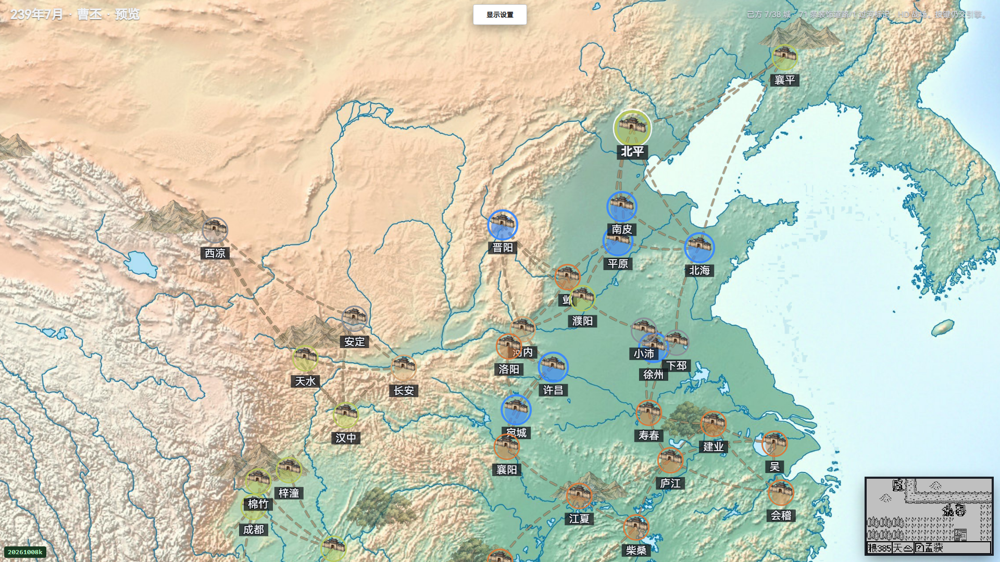
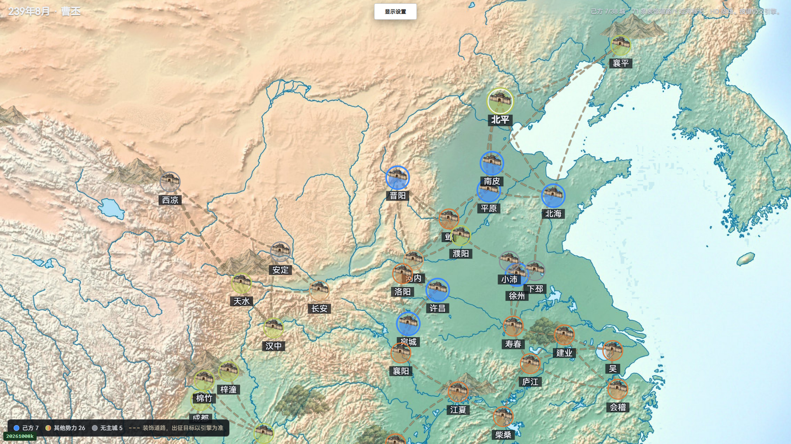

# V39 原版经典显示尝试：流程闭合，WOOD电影目标未完成

本轮从239年7月当前原始双SAVE续接，在1920×1080页面公开切换经典显示并作四次滚木确认。四次均由原版自然失败，WOOD7未执行；成功电影、NUM/HOLD及完整经典像素验收仍缺6/7两族。actualCastAccepted、actualClassicAccepted、hdAccepted和globalHdComplete均为false。

本地Plunder0由44完成，实际到账粮645、钱258后才放行供粮检查；March170携粮481，同一END执行一个自然月。四次MP分别84→64、65→45、46→26、26→6，合计实际支付80、伤害0；中间自然恢复不能抹去。原始190个即时文件、四次失败、全部大流和45张PNG按原字节保留。

独立终审完成15项非像素合同；第16项完整电影oracle因缺族而未运行。原16阶段收据的继承标题保留，scope v2按事实消歧义。8次公开模式切换只证明显示状态切换。原capture文件为3字节空数组，0捕获行、0原生/LCD/HD捕获PNG。独立PNG工具完整校验45张普通截图的SHA、CRC、解压、过滤和RGBA；这些截图没有原生读回映射，不授电影像素信用。透明归一仅允许alpha=0后的RGB归零，其他通道保持精确。

最新公共SAVE为239年8月 wood67-131-v39-wood-route-settled，完整世界和原双文件可逐字节回读。131归属本方、回城7、EXP8，但兵力已从2334自然损失到0；未回填旧兵力，当前不能继续按战斗可用施术者行动。44体力16，城20粮493/钱1086，当前七城严格供粮均安全；这不授权再按END。129仍为俘虏，全部原生队列、外国残留、未知字段和退休订单保留。

执行源581逻辑记录/570显式文件在终态锁定，保存8份关键原源。原版全套133文件7177/7177是本次实跑前的源回归（新增不同用例125=90+35），出版没有重复计数或重跑游戏。实际终态31188/d1acb9/exit0；11个精确进程身份收尾后0存活/0私服，用户8080保持，profile保留。

分卷归档逐原SHA去重gzip，单卷≤8MiB；超卷文件按有序4MiB原字节块保存，完整原文件SHA按顺序增量验证。全190即时原件和支持小证据均收录；不递归旧归档或private profile。完整581源树及Clang环境依赖匹配checkout，portableClosedArchive=false。运行 node docs/validation/m5-wood67-classic-20261024-v39-verify.mjs 可只读回验全部分卷、原件、双SAVE和范围；不重放游戏、不替代完整电影oracle。

